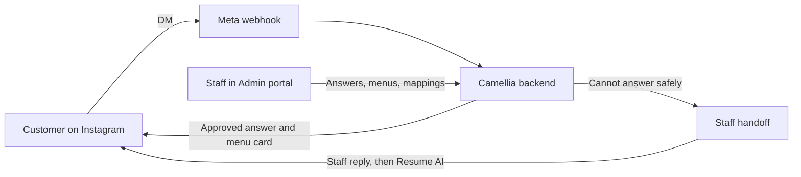

# Camellia Artisanal Instagram Assistant

An Instagram DM assistant for **Camellia Artisanal**, a Bengali food and sondesh brand.
It answers customers with wording the business has approved, sends the right menu card,
understands which ad, post, reel or story a customer came from, and hands anything it
cannot answer safely to a person.

Staff run it from a web Admin portal, without touching code.


## How it works



1. A customer sends a DM. Meta delivers it to a signed webhook.
2. The message is saved first, so it survives a restart, then processed in the background.
3. The bot works out the context: which ad, post, reel or story the customer came from.
4. It picks a reply from approved answers and current menus. AI helps it understand the
   question, but does not write business facts.
5. If no safe answer exists, it opens a human handoff and stays quiet until staff resume it.

The full picture, with diagrams, is in [docs/ARCHITECTURE.md](docs/ARCHITECTURE.md).

## Technology

| Layer | Technology | Used for |
|---|---|---|
| Backend | Python 3.11, FastAPI, Uvicorn | Webhooks, Admin API, background workers |
| Frontend | HTML, CSS and plain JavaScript served by FastAPI | Admin portal at `/admin`, local chat tester at `/chat` |
| Database | SQLite on a persistent volume | Conversations, mappings, answers, menus, handoffs, job queues |
| AI | Groq API (`openai/gpt-oss-120b`, `openai/gpt-oss-20b`, `qwen/qwen3.8-27b`) | Reading customer intent, grounded fallback, reading menu images |
| Integrations | Meta Instagram Graph API, Meta Marketing API | Messages, posts, reels, stories, ads |
| Security | Argon2id, CSRF-protected sessions, signed webhooks, SlowAPI rate limiting | Admin login and webhook trust |
| Images and PDFs | Pillow, pypdfium2 | Menu uploads |
| Hosting | Railway, Docker | Production service |
| Delivery | GitHub Actions, pytest | CI, full test suite, mirror to the client repository |

There is no separate frontend build. No React, no Node, no bundler: the Admin portal ships
inside the Python app, so one deploy updates everything.

## Main features

- **Approved answers.** Customer wording is sent word for word, in ordered text, image,
  menu and Reel blocks.
- **Source-aware replies.** Each ad, post, reel or story can have its own answers.
  Ads inherit the mapping of the post they promote.
- **Custom responses with question variations.** Staff list exact customer phrases on a
  mapping, and those phrases send that mapping's reply.
- **Menu management.** A catalogue, plus a weekly menu published as an image for seven days.
- **Human handoff.** Each handoff gets a CAM reference and mutes the bot for that customer
  until staff press Resume AI or it expires after 72 hours.
- **Admin portal.** Dashboard, Ads, Posts and Reels, Stories, Approved Q&A, Menus,
  Categories and chatbot control.
- **Health reporting.** `GET /health` reports token state, undelivered templates and warnings.

## Repository layout

```text
.
├── main.py              Process entry point
├── camellia/            Application package (backend and Admin portal)
├── data/                Seed menu and approved Q&A templates
├── images/              Menu cards served at /images
├── tests/               Automated test suite
├── scripts/             Operator and benchmark tools (not shipped in the image)
├── docs/                All project documentation (start at docs/README.md)
├── .github/workflows/   CI and client mirror
├── Dockerfile, docker-compose.yml, railway.json, Procfile
├── requirements.txt, requirements-test.txt
└── AGENTS.md            Workflow rules for coding agents
```

## Run it locally

```bash
python -m venv venv
```

Activate it with `venv\Scripts\activate` on Windows or `source venv/bin/activate` on macOS and Linux.

```bash
pip install -r requirements.txt
```

Copy `.env.example` to `.env` and fill in your credentials. Then start the server:

```bash
uvicorn camellia.app:app --reload --port 8000
```

| Page | Address | Notes |
|---|---|---|
| Admin portal | `http://localhost:8000/admin` | Needs `ADMIN_USERNAME` and `ADMIN_PASSWORD_HASH` |
| Health | `http://localhost:8000/health` | Public, no secrets |
| Chat tester | `http://localhost:8000/chat` | Local only, needs `ENABLE_WEB_TESTER=true` |

## Test it

```bash
pip install -r requirements-test.txt
```

```bash
python -m pytest -q tests/test_custom_response_variations.py
```

```bash
python -m pytest -q -n auto -p no:randomly tests
```

Some tests rewrite `data/menu.json`, so restore it after a full run:

```bash
git checkout -- data/menu.json
```

## Deployment

A push to `main` in `s7oaib/ChatBOT` runs CI and mirrors to `Camellia-Artisanal/ChatBot`.
The client's Railway project then deploys it. SQLite and uploads live on the Railway volume.
See the [production runbook](docs/PRODUCTION_RUNBOOK.md).

## Documentation

| Read this | For |
|---|---|
| [docs/README.md](docs/README.md) | Index of every document |
| [docs/ARCHITECTURE.md](docs/ARCHITECTURE.md) | System design and diagrams |
| [docs/FLOW.md](docs/FLOW.md) | Detailed message and admin flows |
| [docs/MEMORY.md](docs/MEMORY.md) | Rules learned from past failures |
| [docs/CLIENT_HANDOVER.md](docs/CLIENT_HANDOVER.md) | Operator handover |

## License

MIT. See [LICENSE](LICENSE).
