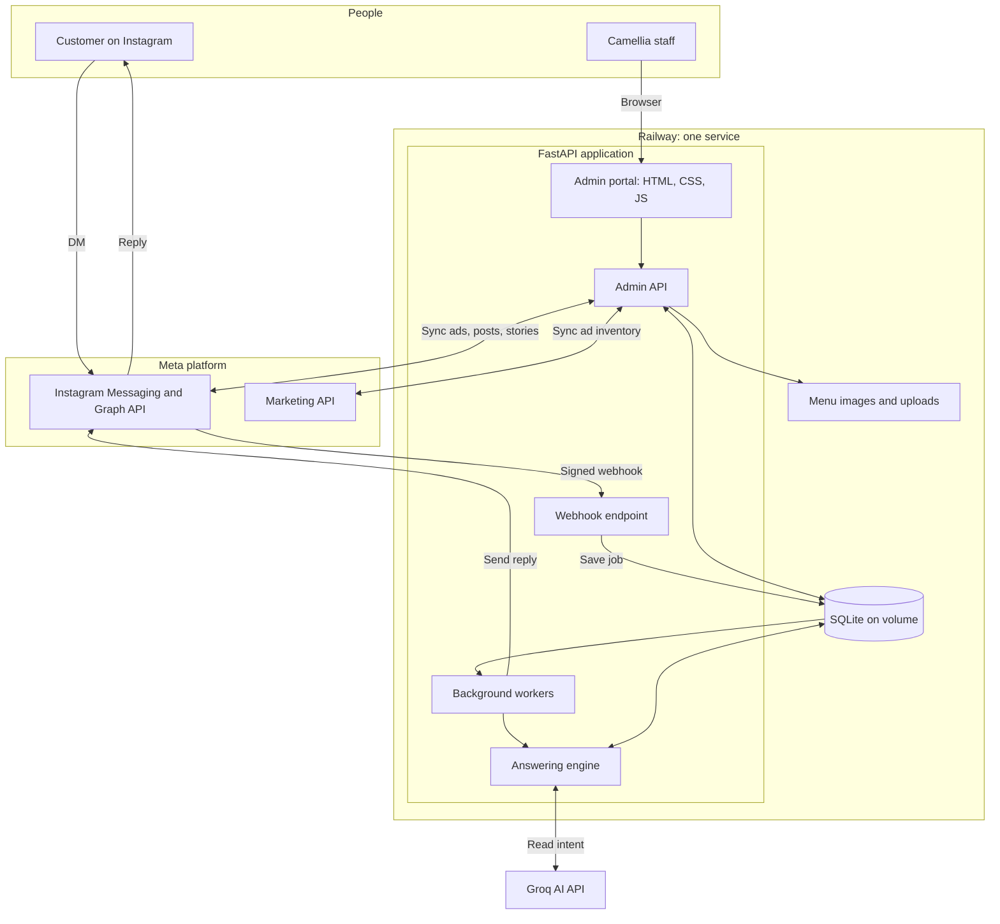
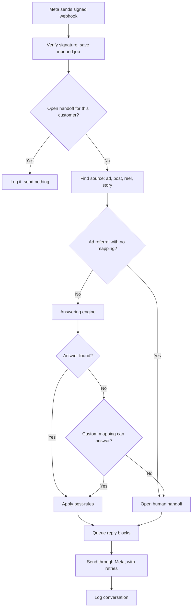
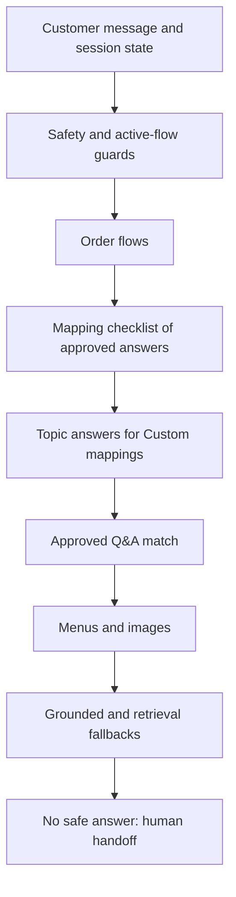
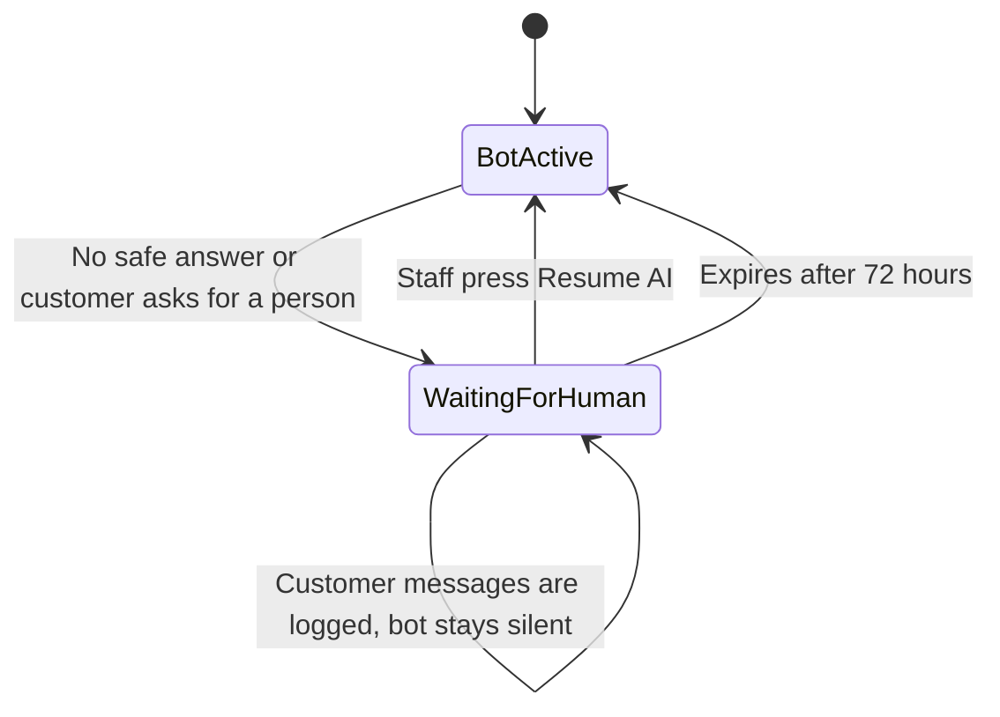
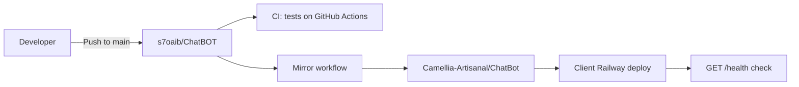

# Camellia Architecture

Instagram DM assistant for Camellia Artisanal (Bengali food, sondesh, Home Table events).
One FastAPI process, one SQLite database, and an Admin portal served by the same app.

Read this with [FLOW.md](FLOW.md) (step-by-step flows), [ANSWERING_DESIGN.md](ANSWERING_DESIGN.md)
(how meaning and sufficiency are decided) and [MEMORY.md](MEMORY.md) (rules from past failures).

## 1. System at a glance



## 2. Technology

### Backend

| Concern | Choice | Why |
|---|---|---|
| Language | Python 3.11 | Production runtime |
| Web framework | FastAPI on Uvicorn | Async webhooks and a JSON Admin API in one process |
| Database | SQLite, on the Railway volume (`/app/var`) | One service, no database server to run |
| HTTP client | httpx | Calls to Meta and Groq |
| Security | argon2-cffi, CSRF sessions, slowapi | Admin login, rate limits |
| Files | Pillow, pypdfium2, python-multipart | Menu image and PDF uploads |

### Frontend

The Admin portal is plain HTML, CSS and JavaScript with no framework and no build step.

- `/admin` is one page, assembled in `app.py` from `HTML` and `SCRIPT` strings in the
  `admin_*.py` modules.
- The page calls the JSON `/admin/*` API with `fetch`.
- `/chat` is a separate local-only tester, and is off unless `ENABLE_WEB_TESTER=true`.

The markup in `app.py` is a raw Python string on purpose. Removing the `r` prefix silently
breaks the whole page ([MEMORY.md](MEMORY.md)).

### AI

| Job | Default model | Setting |
|---|---|---|
| Read customer intent as validated JSON | `openai/gpt-oss-120b` | `GROQ_ROUTER_MODEL` |
| Fallback for that step | `openai/gpt-oss-20b` | `STRUCTURED_NLU_FALLBACK_MODEL` |
| Grounded replies and refinement | `openai/gpt-oss-20b` | `GROQ_MODEL` |
| Read menu images | `qwen/qwen3.8-27b` | `GROQ_VISION_MODEL` |
| Draft question variations for staff to tick | `openai/gpt-oss-20b` | `GROQ_MODEL` |

**AI selects, it does not author.** It reads meaning and emits no customer copy on that path.
Any generated text must pass grounding checks against approved content. If Groq fails, the
bot falls back to deterministic rules or a human handoff, never to a guess.

## 3. What happens to a customer message



Post-rules sit in `_process_instagram_event` in `app.py`. A Custom mapping's listed question
variations and its opt-in "tell me more" option are applied here. Human help requests,
explicit escalation words and an order in progress keep priority.

## 4. How an answer is chosen

The first layer that owns the turn answers.



Approved Q&A is the authority for customer wording, and it is sent word for word.

## 5. How a message finds its source

`route_for_inbound()` in `instagram_routing.py` tries these in order:

1. Ad binding, from Map Ad in the Ads tab.
2. A route with that exact Ad ID.
3. The mapping of the post or reel that the ad promotes.
4. Story ID, then shared post or reel IDs.

An explicit ad referral with no exact route clears earlier context and hands off, so it can
never answer from a previous city or product.

## 6. Human handoff lifecycle



`handoff.py` issues a CAM reference, and `default_handoff_message()` is the only handoff
wording. Staff see pending items in the Admin portal. WhatsApp is a manual `wa.me` link for
order continuation; the service has no WhatsApp bot. `send_human_alert()` transport is
currently disabled, so events persist but no external alert goes out.

## 7. Delivery pipeline



## 8. Code map

| Layer | Modules |
|---|---|
| Entry point | `main.py` |
| Webhook and orchestration | `app.py` |
| Source routing | `instagram_routing.py`, `instagram_ads.py`, `instagram_media.py`, `instagram_story_*.py`, `instagram_source_qa.py` |
| Answering | `responder.py`, `approved_qa.py`, `client_qa.py`, `understanding.py`, `knowledge.py`, `semantic_fallback.py`, `grounded_answers.py`, `rag_fallback.py`, `ai_responder.py` |
| Shadow only | `router.py`, `triage.py` |
| Orders | `order_calculator.py`, `order_intake.py` |
| Menus | `menu_catalogue.py`, `menu_review.py`, `menu_images.py`, `weekly_savoury.py` |
| Handoff | `handoff.py`, `escalator.py` |
| Sessions | `session_memory.py` |
| Admin portal | `admin_ads.py`, `admin_source_response.py`, `admin_approved_qa.py`, `admin_menu_review.py`, `admin_weekly_savoury.py`, `admin_chatbot_control.py`, `admin_handoff_message.py`, `admin_categories.py`, `admin_security.py`, `setup_check.py` |
| Persistence | `database.py` (every table; migrations in `init_db`) |
| Config and health | `config.py`, `monitoring.py` |

To find code quickly, `graphify-out/` holds a local code graph:

```bash
graphify query "where is the handoff text chosen"
```

```bash
graphify update .
```

## 9. Key data

| Table | Meaning |
|---|---|
| `instagram_source_routes` | A mapping: source type, identity, response mode (CUSTOM or APPROVED_QA), topic, menu, generic-info toggle, exact question variations |
| `instagram_source_ad_bindings` | Meta Ad ID to mapping |
| `instagram_ads_manual_sync_jobs` | Status of the background Ads, Posts, Reels and Stories refresh |
| `instagram_source_qa_bundles` (+`_items`) | Checklist of approved answers for a mapping |
| `instagram_topics` | Mapping topics and their default answers |
| `approved_qa_overrides` (+`_versions`) | Admin edits and new answers |
| `approved_qa_contexts` | Client-added categories |
| `menu_catalogue`, `menu_versions`, `menu_image_versions`, `menu_customer_topics` | Menus and what customers can see |
| `instagram_inbound_jobs`, `instagram_outbound_jobs` | Durable message queues |
| `cross_channel_handoffs` | Handoffs (WAITING_FOR_HUMAN mutes the bot) |
| `conversations` | Every turn, with template, ad and source diagnostics; no raw webhook body |

## 10. Admin Dashboard details

The Setup Check comes from `setup_check.py`. Its route findings carry a routing ID, so staff
can open the matching editor directly. Pending escalations sit under one collapsed section
with plain rows showing customer, question and source preview. Escalations are separate
records and are never treated as answer drafts.

## 11. Runtime and tests

| Piece | Where |
|---|---|
| Production | Client's Railway project `camellia-artisanal-production` |
| Storage | `DB_PATH=/app/var/camellia.db`; `menu.json` and uploads beside it |
| Health | `GET /health`; its warnings list is the first place to look |

```bash
python -m pytest -q tests/test_<area>.py
```

```bash
python -m pytest -q -n auto -p no:randomly tests
```

```bash
git checkout -- data/menu.json
```

```bash
python -m pytest -q --lf -p no:randomly tests
```

The last command reruns failures serially, and that result is the verdict.
